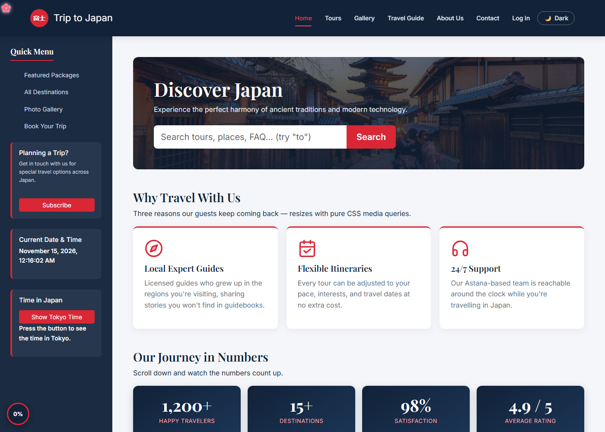
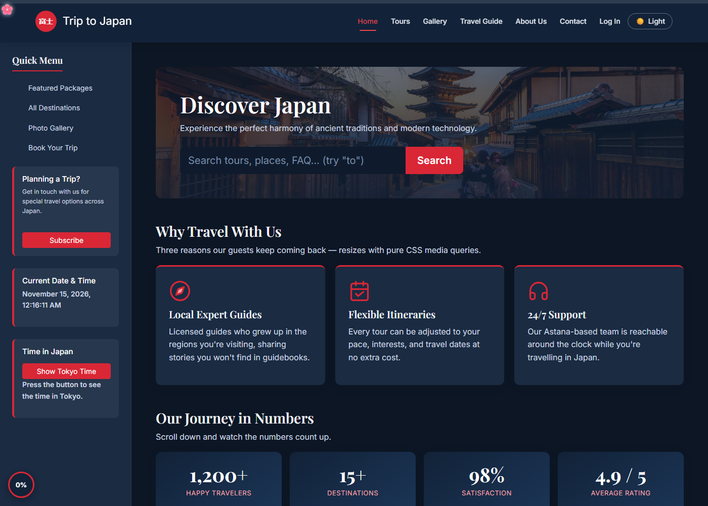
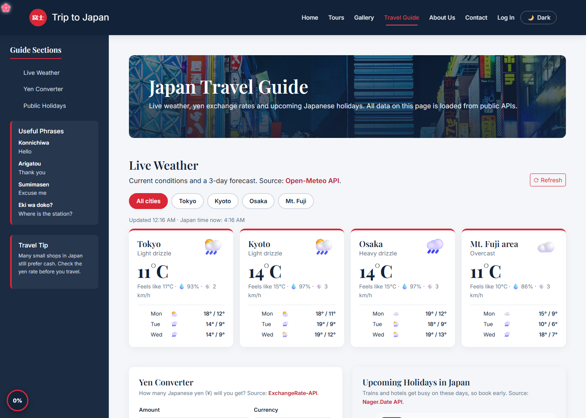
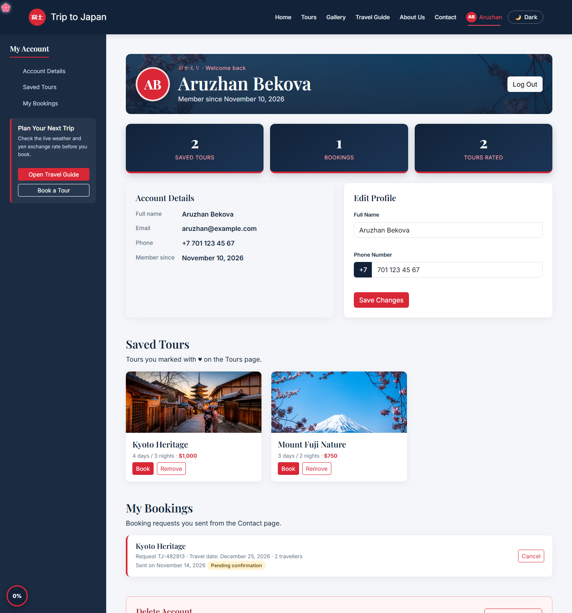
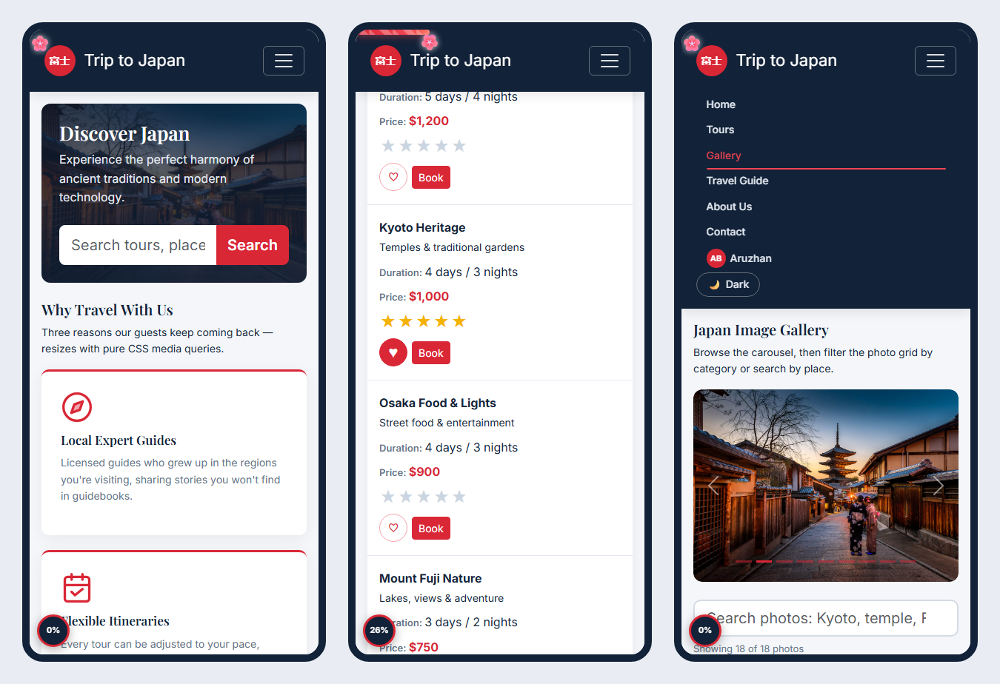

# 🗾 Trip to Japan — Final Project

**Trip to Japan** is a multi-page responsive website for a travel agency that organises guided tours to
**Tokyo, Kyoto, Osaka and Mount Fuji** for students and young travellers from Kazakhstan.
Users can compare tours, browse photos, check live weather and the yen exchange rate,
create an account, save favourite tours and send booking requests.

🌐 **Live website:** https://maqsatcr7.github.io/Trip-to-japan-FINAL-project/trip-to-japan/
📁 **Repository:** https://github.com/MaqsatCR7/Trip-to-japan-FINAL-project



## 👥 Team — Jalan Jalan Japan

| Member | Role |
|--------|------|
| **Maqsat Nauanuly** | Project manager & designer — structure, colour palette, layouts, light/dark design, responsive testing |
| **Tolendi Arsen** | Developer & content creator — JavaScript & jQuery, authentication, validation, APIs, content |

Astana IT University · Web Technologies · 2026

## 📄 Pages

| Page | Description |
|------|-------------|
| `index.html` | Home: hero search with autocomplete, animated counters, featured tours, subscribe popup |
| `tours.html` | Tours table with live search, city filter, sorting, star rating, save to profile (♥) and booking |
| `gallery.html` | Carousel and photo grid with category filter, search and lazy loading |
| `guide.html` | Travel Guide with live weather, yen converter and Japanese public holidays (APIs) |
| `about.html` | Mission, team and FAQ accordion with search highlighting |
| `contact.html` | Booking form with full JavaScript validation |
| `signup.html` | Sign Up — creates an account in localStorage |
| `login.html` | Log In — checks credentials and redirects to the profile |
| `profile.html` | Profile — user details, edit profile, saved tours, bookings, log out, delete account |

## ✨ Features

- **Responsive design** — CSS Grid, Flexbox and Bootstrap 5; the tours table turns into cards on phones.
- **Light / Dark mode** — toggle in the navbar, saved in `localStorage` and applied on every page.
- **Authentication simulation** — Sign Up stores name, email, phone and password; Log In checks them and opens the Profile page.
- **Form validation** — all forms use `novalidate` and JavaScript only: required fields, email format, password length and complexity, phone number pattern. Errors are shown under each field.
- **Search & filtering** — tours (search, filter, sort), gallery (category + search), FAQ search, autocomplete, weather filter. Choices are saved in `localStorage`.
- **Animations** — button hover effects, spinning icons, card lift, heart and star "pop", skeleton loading, scroll progress bar, number counters.
- **External APIs** (with loading state and error handling):
  - [Open-Meteo](https://open-meteo.com/) — live weather and 3-day forecast for 4 places
  - [ExchangeRate-API](https://www.exchangerate-api.com/) — yen exchange rates (KZT, USD, EUR, RUB)
  - [Nager.Date](https://date.nager.at/) — upcoming public holidays in Japan

| Dark mode | Travel Guide (APIs) |
|-----------|---------------------|
|  |  |

| Profile | Mobile view |
|---------|-------------|
|  |  |

## ✅ Requirements checklist

| # | Requirement | Status | How / where |
|---|-------------|:------:|-------------|
| – | 6+ connected pages | ✅ | 9 pages with the same navbar and footer |
| 1 | Responsiveness | ✅ | CSS Grid, Flexbox, Bootstrap 5, media queries; tested on phone, tablet, desktop |
| 2 | Hosting | ✅ | GitHub Pages — links at the top of this README |
| 3 | Light / Dark modes | ✅ | Navbar toggle, saved in `localStorage`, same on every page |
| 4 | Design & UX | ✅ | Japanese red + navy palette, Playfair Display + Inter, photos and SVG icons |
| 5.1 | Authentication simulation | ✅ | `signup.html` → `login.html` → `profile.html` |
| 5.2 | Form validation | ✅ | Email, password length + complexity, required fields, phone pattern; `novalidate`, no HTML validation attributes |
| 5.3 | Search / filtering | ✅ | Tours, gallery, FAQ, autocomplete, weather filter — saved in `localStorage` |
| 6 | Animations | ✅ | Hover effects, icon spin, pop animations, skeleton loading |
| 7 | External API | ✅ | Open-Meteo, ExchangeRate-API, Nager.Date with loading and error states |
| 8 | Feature cohesion | ✅ | Every feature helps to plan and book a trip to Japan |
| 10 | Code quality | ✅ | Required folder structure, commented code, meaningful names |

## 🗂 Project structure

```
/trip-to-japan
├── index.html
├── tours.html
├── gallery.html
├── guide.html
├── about.html
├── contact.html
├── login.html
├── signup.html
├── profile.html
├── /css/style.css
├── /js/script.js
└── /images/
    ├── favicon.svg
    └── /icons/
```

## 🛠 Technologies

HTML5 · CSS3 · JavaScript (ES6, async/await) · Bootstrap 5.3 · jQuery 4 · localStorage · Fetch API · GitHub Pages

## ▶️ Run locally

Download the repository and open `trip-to-japan/index.html` in a browser,
or start a local server inside the `trip-to-japan` folder:

```bash
python -m http.server 8000
```

> **Note:** accounts are only a simulation for this university project — passwords are kept in the browser's
> localStorage. A real website must store them securely on a server.
